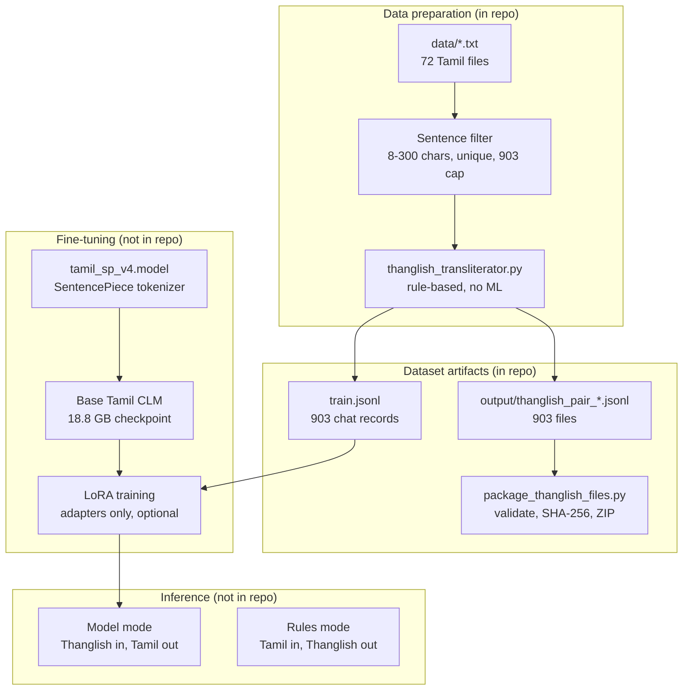

# Thanglish Agent

Fine-tuning data pipeline and RunPod notebook for a **Thanglish → Tamil** converter: the model reads Tamil written in Latin letters ("Thanglish") and returns natural Tamil script, with no explanation.

Real Thanglish text is scarce, so the dataset is built backwards. Real Tamil sentences are transliterated by a deterministic rule engine to produce the Thanglish side, then the pair is flipped: **Thanglish is the input, the original Tamil is the target.** Labels are always genuine Tamil; inputs are synthetic.

> **Scope of this repo.** It is a **data pipeline**, not a working agent. It contains the data-preparation code (`convert_data_to_thanglish_jsonl.py`, `thanglish_transliterator.py`, `package_thanglish_files.py`), a dataset check (`verify_dataset.py`), the 903-pair dataset, `requirements.txt` and the RunPod notebook. No agent or tool use is implemented, and no model has been trained or evaluated in this repo.
>
> The notebook also calls files that are **not in this repo**: `scripts/` (`download_drive.py`, `check_environment.py`, `prepare_dataset.py`, `evaluate_rules.py`, `parameter_report.py`, `infer.py`, `train_lora.py`), `tests/`, the tokenizer `models/tamil_sp_v4.model`, and the 18.8 GB checkpoint `model_download/tl_clm_model.zip`. Without them the notebook's Cells 1 and 4 to 10 cannot run; the data pipeline below works on its own.

## Architecture



## Methodology

1. **Corpus.** `data/` holds 72 plain-text Tamil files (mostly news and film-credit style lines).
2. **Sentence filter** (`convert_data_to_thanglish_jsonl.py`). Files are read in alphabetical order and split on line breaks. A line is kept if it is 8-300 characters, contains at least one Tamil-block character, and has not been seen before. Collection stops at 903 unique lines (`TARGET_COUNT`), so the dataset is a slice from the first files, not a sample of the whole corpus.
3. **Transliteration** (`thanglish_transliterator.py`). Table-driven, no machine learning:
   - split text into word and punctuation tokens;
   - check each word against `SPECIAL_WORDS`, an 18-entry dictionary of colloquial forms (e.g. `போறேன்` → `poren`);
   - otherwise split into Tamil letters with `tamil.utf8.get_letters` (open-tamil) and look each letter up in a table built from consonants and vowel signs (க+ா → `kaa`, ே → `ae`, ழ → `zh`); unknown characters pass through unchanged;
   - final cleanup: `replace("thth", "tth")`.
4. **Record format.** Each pair becomes a chat-style prompt/completion record: a fixed Tamil system prompt ("convert the user's Thanglish to natural Tamil; output only the Tamil"), the Thanglish as the user turn, and the Tamil as the assistant turn.
5. **Outputs.** 903 records go to `train.jsonl` and to 903 single-record files in `output/`.
6. **Packaging** (`package_thanglish_files.py`). Requires exactly 903 files, checks each parses as JSON with `prompt` and `completion` lists, writes a manifest with SHA-256 hashes, zips with CRC verification, then renames atomically.

## Algorithm and parameters

| Part | Technique | Parameters |
|---|---|---|
| Transliterator | Dictionary override + per-letter lookup table | 18 special words; table covers vowels, consonants, and all consonant+vowel-sign pairs |
| Base model | Pretrained Tamil causal language model (`tl_clm_model`) with SentencePiece tokenizer `tamil_sp_v4` | Exact parameter count is not measured in the repo; the notebook only reports it once the checkpoint is present (`parameter_report.py`). Checkpoint size is 18.8 GB. |
| Adaptation | Optional LoRA (adapters only, not training from scratch) | Hyperparameters live in `train_lora.py`, which is not in this repo |
| Data | 903 unique pairs, Tamil sentences of 8-300 characters (mean about 127) | |

## Input and output

- **Input:** Thanglish text (Latin letters).
- **Output:** Tamil script only, no explanation (enforced by the system prompt).
- The transliteration is lossy, which is what the model must resolve from context: ந/ன/ண all become `n`, ல/ள become `l`, ர/ற become `r`.

## Running on RunPod (RTX 5090)

`Thanglish Agent.ipynb` drives the whole project by calling scripts in `/workspace/thanglish_transliteration`. Unzip the full project there first. The model, the real 903-file dataset and the original tokenizer must be provided separately.

| Cell | Purpose | Notes |
|---|---|---|
| Setup | Check `ROOT/scripts/download_drive.py` exists | Project must be unzipped into `/workspace/thanglish_transliteration` |
| 1 | `pip install -r requirements.txt`, then `check_environment.py` | Dependencies and GPU check |
| 2 | Optional model download | `RUN_DOWNLOAD=False` by default; `DOWNLOAD_METHOD` is `gdown` or `direct`; HTML or quota-error responses are rejected |
| 3 | Optional dataset download | `DATASET_ID` is empty and must be set to your real Drive ZIP ID |
| 4 | Import training data | `DEMO_ONLY=True` uses 60 example pairs only; set it to `False` to use `data/raw/thanglish_data.zip` |
| 5 | `evaluate_rules.py` | 60 reference transliteration samples |
| 6 | `pytest -q tests` | Automated tests |
| 7 | `parameter_report.py` | Needs the real checkpoint |
| 8 | `infer.py --mode rules` | Deterministic Tamil → Thanglish baseline |
| 9 | `infer.py --mode model` | Needs checkpoint and `models/tamil_sp_v4.model` |
| 10 | `train_lora.py` | `RUN_LORA_TRAINING=False` by default; do not enable with the demo set |

## Rebuilding and verifying the dataset locally

```bash
pip install open-tamil
python convert_data_to_thanglish_jsonl.py   # writes output/ and train.jsonl
python package_thanglish_files.py           # verified ZIP beside output/
python verify_dataset.py --regen            # checks the dataset (see below)
```

Both build scripts hard-code `C:\Users\saivi\Downloads\thanglish data`; edit `WORKSPACE_DIR` / `DATA_DIR` for your machine. `verify_dataset.py` reads `train.jsonl` next to itself and needs no path edits. (`requirements.txt` lists extra packages for the model and LoRA cells that the data pipeline itself does not need.)

## Measured results

`python verify_dataset.py --regen` on the committed `train.jsonl` (reproducible, no GPU, no checkpoint):

| Check | Result |
|---|---|
| Records | 903 |
| Schema (system + user to assistant, non-empty) | pass |
| Tamil targets unique / Thanglish inputs unique | 903 / 903 |
| Transliterator regenerates every Thanglish input from its Tamil target | 903 of 903 |
| Tamil sentence length (characters) | min 11, mean 127.1, median 126, max 298 |
| Thanglish input length (characters, mean) | 149.7 |

This shows the dataset is internally consistent and reproducible from the rules. It is **not** a model result: no model accuracy, perplexity or latency has been measured, and the transliterator's output has not been compared against human-written Thanglish.

## Known limitations

- Training inputs come from one fixed rule set, so the model learns to invert those exact rules (`thaevi`, `vengkataechan`) rather than how people really type ("enna panra", "romba nalla irukku"). Expect a distribution gap on real chat text.
- Only 18 words receive colloquial treatment, and the Tamil side is mostly formal or literary.
- `replace("kk", "kk")` in the transliterator is a no-op.
- Dependencies are unpinned in `requirements.txt` (the scripts that would fix exact versions are not in this repo).
- The "60 reference transliteration samples" evaluation (notebook Cell 5) depends on `evaluate_rules.py`, which is not in this repo, so there is no human-checked accuracy figure for the transliterator.
