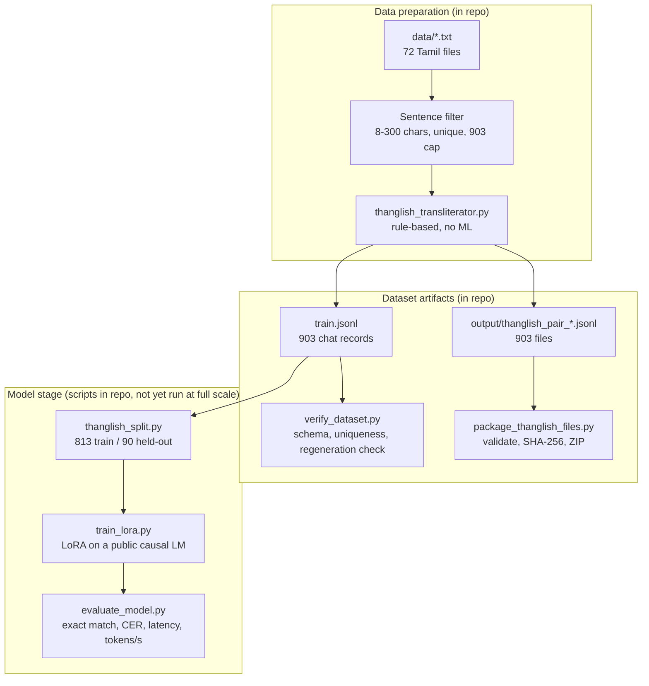

# Thanglish Agent

Dataset pipeline for a **Thanglish → Tamil** converter: a model that reads Tamil written in Latin letters ("Thanglish") and returns natural Tamil script, with no explanation.

Real Thanglish text is scarce, so the dataset is built backwards. Real Tamil sentences are transliterated by a deterministic rule engine to produce the Thanglish side, then the pair is flipped: **Thanglish is the input, the original Tamil is the target.** Labels are always genuine Tamil; inputs are synthetic.

> **Scope of this repo.** It is mainly a **data pipeline**: the transliterator, the dataset builder, a dataset check, a packager, the 903-pair dataset and a notebook that runs them. It also contains LoRA training and evaluation scripts for a **public** base model (see [Model stage](#model-stage-lora-scripts-included-not-yet-run-at-full-scale)). Those scripts have only been smoke-tested (2 training steps and 2 evaluations on CPU); **no trained model or evaluation result is reported yet**. There is no agent or tool use.

## Architecture



## Methodology

1. **Corpus.** `data/` holds 72 plain-text Tamil files (mostly news and film-credit style lines).
2. **Sentence filter** (`convert_data_to_thanglish_jsonl.py`). Files are read in alphabetical order and split on line breaks. A line is kept if it is 8-300 characters, contains at least one Tamil-block character, and has not been seen before. Collection stops at 903 unique lines (`TARGET_COUNT`), so the dataset is a slice from the first files, not a sample of the whole corpus.
3. **Transliteration** (`thanglish_transliterator.py`). Table-driven, no machine learning:
   - split text into word and punctuation tokens;
   - check each word against `SPECIAL_WORDS`, an 18-entry dictionary of colloquial forms (e.g. `போறேன்` → `poren`);
   - otherwise split into Tamil letters with `tamil.utf8.get_letters` (open-tamil) and look each letter up in a table built from consonants and vowel signs (க+ா → `kaa`, ே → `ae`, ழ → `zh`); unknown characters pass through unchanged;
   - final cleanup: `replace("thth", "tth")`.
4. **Record format.** Each pair becomes a chat-style prompt/completion record: a fixed Tamil system prompt ("convert the user's Thanglish to natural Tamil; output only the Tamil"), the Thanglish as the user turn, and the Tamil as the assistant turn.
5. **Outputs.** 903 records go to `train.jsonl` and to 903 single-record files in `output/`.
6. **Verification** (`verify_dataset.py`). Checks count, schema, uniqueness and length statistics, and with `--regen` re-runs the transliterator on every Tamil target to confirm it reproduces the stored Thanglish input.
7. **Packaging** (`package_thanglish_files.py`). Requires exactly 903 files, checks each parses as JSON with `prompt` and `completion` lists, writes a manifest with SHA-256 hashes, zips with CRC verification, then renames atomically.

## Input and output

- **Input:** Thanglish text (Latin letters).
- **Output:** Tamil script only, no explanation (enforced by the system prompt).
- The transliteration is lossy, which is what a model would have to resolve from context: ந/ன/ண all become `n`, ல/ள become `l`, ர/ற become `r`.

## Running it

```bash
pip install -r requirements.txt             # installs open-tamil
python convert_data_to_thanglish_jsonl.py   # writes output/ and train.jsonl (deterministic)
python verify_dataset.py --regen            # checks the dataset
python package_thanglish_files.py           # verified ZIP beside output/
```

All scripts resolve paths relative to their own location, so they run from a clone on any machine. `Thanglish Agent.ipynb` runs the same four steps in order (run it from the repo root) and prints a few sample pairs. Rebuilding reproduces the committed `train.jsonl` exactly.

## Measured results

`python verify_dataset.py --regen` on the committed `train.jsonl` (reproducible, no GPU, no checkpoint):

| Check | Result |
|---|---|
| Records | 903 |
| Schema (system + user to assistant, non-empty) | pass |
| Tamil targets unique / Thanglish inputs unique | 903 / 903 |
| Transliterator regenerates every Thanglish input from its Tamil target | 903 of 903 |
| Tamil sentence length (characters) | min 11, mean 127.1, median 126, max 298 |
| Thanglish input length (characters, mean) | 149.7 |

This shows the dataset is internally consistent and reproducible from the rules. It is **not** a model result: no model accuracy, perplexity or latency has been measured, and the transliterator's output has not been compared against human-written Thanglish.

## Model stage (LoRA scripts included, not yet run at full scale)

Scripts that adapt a **public** causal LM (default `Qwen/Qwen2.5-0.5B-Instruct`; `Qwen/Qwen2.5-1.5B-Instruct` also works) to Thanglish → Tamil with LoRA, and measure the result on held-out data. They are new, written for this repo, and are **not** the original private scripts mentioned in earlier versions of the notebook.

| File | Purpose |
|---|---|
| `thanglish_split.py` | Deterministic split of `train.jsonl`: 813 training records and 90 held-out records (seed 42), shared by both scripts |
| `train_lora.py` | LoRA fine-tuning (rank 16, all attention and MLP projections); loss only on the Tamil answer; writes the adapter and `results/train_info.json` (parameter counts, loss, time, GPU) |
| `evaluate_model.py` | Greedy generation on the 90 held-out records; reports exact match, character error rate (CER, can exceed 1.0 when the output is longer than the reference), mean latency and tokens per second; writes `results/eval_base.json` or `results/eval_lora.json` |
| `requirements-lora.txt` | `torch`, `transformers`, `peft`, `accelerate` (unpinned) |

Run on a GPU (for example a Colab T4):

```bash
pip install -r requirements.txt -r requirements-lora.txt
python evaluate_model.py                                # baseline: base model, no adapter
python train_lora.py                                    # 3 epochs, writes adapters/thanglish_lora
python evaluate_model.py --adapter adapters/thanglish_lora
```

**Verified so far.** In a CPU smoke test, training ran for 2 steps, saved and reloaded an adapter, and evaluation ran with and without it. For `Qwen2.5-0.5B-Instruct` this showed 494,032,768 base parameters and 8,798,208 trainable LoRA parameters (1.78%). The untuned base model fails the task outright (on 2 records it answered in English and invented content, CER above 1), so a before/after comparison is meaningful. **No full training run or evaluation result exists yet**; the numbers belong in this README only after the commands above have been run.

**How to read the result.** The Thanglish inputs are produced by the rule engine, so a good score here means the model learned to invert those rules on unseen sentences, **not** that it understands real chat Thanglish. The held-out records are a random sample of the same 903 lines (first files in alphabetical order, many film-credit style lines), so near-duplicate lines can appear on both sides.

## Known limitations

- Training inputs come from one fixed rule set, so a model would learn to invert those exact rules (`thaevi`, `vengkataechan`) rather than how people really type ("enna panra", "romba nalla irukku"). Expect a distribution gap on real chat text.
- Only 18 words receive colloquial treatment, and the Tamil side is mostly formal or literary.
- The dataset is the first 903 unique lines in alphabetical file order, not a random sample of the corpus.
- `replace("kk", "kk")` in the transliterator is a no-op.
- There is no human-checked accuracy figure for the transliterator.
- The model-stage scripts have not been run on a GPU at full scale, and no result from them is claimed.
