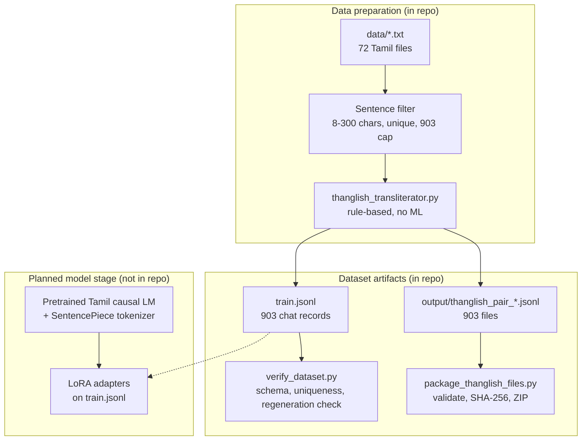

# Thanglish Agent

Dataset pipeline for a **Thanglish → Tamil** converter: a model that reads Tamil written in Latin letters ("Thanglish") and returns natural Tamil script, with no explanation.

Real Thanglish text is scarce, so the dataset is built backwards. Real Tamil sentences are transliterated by a deterministic rule engine to produce the Thanglish side, then the pair is flipped: **Thanglish is the input, the original Tamil is the target.** Labels are always genuine Tamil; inputs are synthetic.

> **Scope of this repo.** It is a **data pipeline only**: the transliterator, the dataset builder, a dataset check, a packager, the 903-pair dataset and a notebook that runs them. It contains **no model, no training or inference code, and no agent or tool use**, and no model has been trained or evaluated here. The planned model stage is described under [Planned model stage](#planned-model-stage-not-in-this-repo).

## Architecture



## Methodology

1. **Corpus.** `data/` holds 72 plain-text Tamil files (mostly news and film-credit style lines).
2. **Sentence filter** (`convert_data_to_thanglish_jsonl.py`). Files are read in alphabetical order and split on line breaks. A line is kept if it is 8-300 characters, contains at least one Tamil-block character, and has not been seen before. Collection stops at 903 unique lines (`TARGET_COUNT`), so the dataset is a slice from the first files, not a sample of the whole corpus.
3. **Transliteration** (`thanglish_transliterator.py`). Table-driven, no machine learning:
   - split text into word and punctuation tokens;
   - check each word against `SPECIAL_WORDS`, an 18-entry dictionary of colloquial forms (e.g. `போறேன்` → `poren`);
   - otherwise split into Tamil letters with `tamil.utf8.get_letters` (open-tamil) and look each letter up in a table built from consonants and vowel signs (க+ா → `kaa`, ே → `ae`, ழ → `zh`); unknown characters pass through unchanged;
   - final cleanup: `replace("thth", "tth")`.
4. **Record format.** Each pair becomes a chat-style prompt/completion record: a fixed Tamil system prompt ("convert the user's Thanglish to natural Tamil; output only the Tamil"), the Thanglish as the user turn, and the Tamil as the assistant turn.
5. **Outputs.** 903 records go to `train.jsonl` and to 903 single-record files in `output/`.
6. **Verification** (`verify_dataset.py`). Checks count, schema, uniqueness and length statistics, and with `--regen` re-runs the transliterator on every Tamil target to confirm it reproduces the stored Thanglish input.
7. **Packaging** (`package_thanglish_files.py`). Requires exactly 903 files, checks each parses as JSON with `prompt` and `completion` lists, writes a manifest with SHA-256 hashes, zips with CRC verification, then renames atomically.

## Input and output

- **Input:** Thanglish text (Latin letters).
- **Output:** Tamil script only, no explanation (enforced by the system prompt).
- The transliteration is lossy, which is what a model would have to resolve from context: ந/ன/ண all become `n`, ல/ள become `l`, ர/ற become `r`.

## Running it

```bash
pip install -r requirements.txt             # installs open-tamil
python convert_data_to_thanglish_jsonl.py   # writes output/ and train.jsonl (deterministic)
python verify_dataset.py --regen            # checks the dataset
python package_thanglish_files.py           # verified ZIP beside output/
```

All scripts resolve paths relative to their own location, so they run from a clone on any machine. `Thanglish Agent.ipynb` runs the same four steps in order (run it from the repo root) and prints a few sample pairs. Rebuilding reproduces the committed `train.jsonl` exactly.

## Measured results

`python verify_dataset.py --regen` on the committed `train.jsonl` (reproducible, no GPU, no checkpoint):

| Check | Result |
|---|---|
| Records | 903 |
| Schema (system + user to assistant, non-empty) | pass |
| Tamil targets unique / Thanglish inputs unique | 903 / 903 |
| Transliterator regenerates every Thanglish input from its Tamil target | 903 of 903 |
| Tamil sentence length (characters) | min 11, mean 127.1, median 126, max 298 |
| Thanglish input length (characters, mean) | 149.7 |

This shows the dataset is internally consistent and reproducible from the rules. It is **not** a model result: no model accuracy, perplexity or latency has been measured, and the transliterator's output has not been compared against human-written Thanglish.

## Planned model stage (not in this repo)

The intended next step is to adapt a pretrained Tamil causal language model (with a SentencePiece tokenizer) using LoRA adapters trained on `train.jsonl`, then compare it against the rule engine run in reverse. None of that code, the base checkpoint or the tokenizer is included here, so there is no parameter count or evaluation to report yet.

## Known limitations

- Training inputs come from one fixed rule set, so a model would learn to invert those exact rules (`thaevi`, `vengkataechan`) rather than how people really type ("enna panra", "romba nalla irukku"). Expect a distribution gap on real chat text.
- Only 18 words receive colloquial treatment, and the Tamil side is mostly formal or literary.
- The dataset is the first 903 unique lines in alphabetical file order, not a random sample of the corpus.
- `replace("kk", "kk")` in the transliterator is a no-op.
- There is no human-checked accuracy figure for the transliterator.
